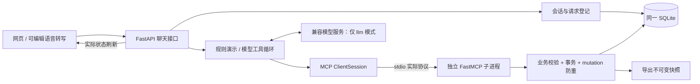

# 课伴 v0.1：架构与实际接口

本文件描述已实现代码；原任务包是设计建议，存在以下明确差异：业务路由集中在 `backend/main.py`，工具注册在 `backend/mcp_server.py`；首版使用浏览器 Web Speech，没有 `/api/audio/transcribe`；偏好写入经聊天 action → MCP，而不是另设 PUT 路由；导出快照登记在同一 SQLite 后返回附件，没有散落的本地文件。增加了只读 `/plan` 快照接口、`get_plan` 与确定性 `propose_schedule` 工具。没有增加第二套数据库或第二个 Agent。

## 执行链路



每次聊天持有单独 MCP 会话，发现工具后执行并在同一协程关闭。前后端同源，不需要 CORS。应用首次启动真实发现12个工具（含web_search）；没有搜索配置时，该工具不暴露给模型。工具发现失败会中止启动；发现成功不代表供应商网络可达。后续可优化MCP子进程复用。

## 模块位置

| 方向 | 文件 | 优化入口 |
| --- | --- | --- |
| A 智能体 | `backend/agent/runner.py`、`backend/mcp_client.py` | 提示、工具循环、模型适配 |
| B 工具数据 | `backend/mcp_server.py`、`backend/services/`、`backend/storage/` | 排程、规则、schema 与查询 |
| C 页面 | `frontend/index.html`、`styles.css`、`app.js` | 界面、状态与操作 |
| D 记忆语音 | `backend/memory/store.py`、`frontend/speech.js` | 记忆恢复、识别、朗读 |
| E 导出交付 | `backend/exports/`、`scripts/`、`tests/`、`docs/` | Markdown、验收、启动 |

## HTTP

| 路由 | 用途 |
| --- | --- |
| GET / POST `/api/projects` | 列出本机项目；按名称、初始成员与防重请求 ID 新建项目 |
| GET `/api/health` | 模式、是否配置密钥、模型名、工具数量、当前时间，不返回密钥 |
| POST `/api/sessions` | `{project_id}` 创建会话 |
| GET `/api/sessions/{id}?project_id=...` | 可显示历史、当前草案、焦点 |
| POST `/api/chat` | `{project_id,session_id,request_id,message,action}` |
| GET `/api/projects/{id}/plan` | 成员、任务、偏好、日程、版本的一致快照 |
| GET `/api/projects/{id}/members` | 项目成员 |
| GET `/api/projects/{id}/tasks?status=&assignee_id=` | 任务筛选 |
| GET `/api/projects/{id}/schedule` | `{blocks,version}` |
| GET `/api/projects/{id}/preferences/{member_id}` | 成员的 windows |
| GET `/api/downloads/{file_id}?project_id=...` | 已登记快照的 Markdown 附件 |

聊天响应字段：`ok/reply/tool_events/changed_ids/draft/download/sources/error`。sources来自本轮搜索实际返回的标题与URL，保存到会话，前端用文本节点渲染为独立链接卡片并可刷新恢复。工具事件注明MCP或应用校验，本地草案组装不伪装成MCP事件。不输出模型隐藏推理。HTTP非2xx和业务ok:false均呈现，之后仍刷新实际状态。

支持的前端 action：

```json
{"type":"apply_draft","draft_id":"服务端返回的 ID"}
{"type":"update_task","task_id":"真实 ID","patch":{"status":"done"}}
{"type":"set_preferences","assignee_id":"member_a","windows":[{"start_at":"2030-10-24T19:00:00+08:00","end_at":"2030-10-24T21:00:00+08:00"}]}
{"type":"clear_schedule"}
```

action 是用户在页面明确点击的操作，直接经过同一 MCP 执行链路，不必多花一次模型调用。采用草案只接受 ID，数据从当前项目/会话读取，24 小时过期。

## 工具与范围

真实MCP工具：`manage_member/list_tasks/create_tasks/update_task/get_preferences/set_preferences/check_schedule/propose_schedule/save_schedule/get_plan/export_plan/web_search/get_weather`。

web_search固定请求Tavily官方基础搜索接口，不提供任意URL抓取或代码执行。全主机用量/10分钟缓存保存在web_search_calls，网络请求不占数据库事务写锁；每月默认100次外部尝试、每轮最多3次，失败保守计数。响应限1MiB、总超时22秒、最多5条摘要；验证来源URL并清理凭据回显。网页为不可信资料，搜索后同轮阻止业务写入和草案生成。搜索摘要可能过期，检索时间不等于发布日期，不保证最新事实准确。

模型可见 schema 从实际 MCP 定义转换，去除可信上下文 `project_id/mutation_id`；客户端注入这些参数，禁止模型覆盖。`draft_tasks/draft_schedule` 是 Agent 本地编排工具，会调用真实 MCP 查询/排程，不冒充远端工具。模型无法直接保存非空日程，须生成草案让用户采用。

## 数据可靠性

任务字段统一为 `id/project_id/title/description/assignee_id/deadline/estimated_minutes/status`。状态 `todo/doing/paused/done`。暂停保留截止、工时和已有日程，仍计入未完成任务；继续改回 doing。旧库启动时在事务内升级 tasks 的 CHECK 约束，保留任务 ID、日程关联和外键检查。日程是半开区间 `[start,end)`，相邻允许。排程从未完成任务和已保存可用时间出发，采用最早截止优先，可以拆成多个块，不使用未声明的默认空闲时间。

所有写操作及其 mutation 防重结果共用 `BEGIN IMMEDIATE` 事务；批量任一项失败全部回滚。同 ID 不同内容拒绝。采用一个草案使用与请求 ID 无关的稳定 mutation，防止采用后中断导致重复创建。

请求在发模型前持久登记；同 request_id 同内容返回已缓存结果，不同内容返回 409；处理中或中断状态不自动重放。首版为单 HTTP 进程，同会话串行。跨会话共享项目任务与偏好，焦点及草案只属于各自会话。保留最近 24 个完整回合，模型使用最近 12 个，工具消息成对保留。重启后由 SQLite 恢复，不靠浏览器保存业务状态。

保存日程先检查版本，再检查成员/任务对应、重叠、可用范围、截止与完整工时覆盖，成功才整批替换。更改已安排任务关键字段会要求先清空日程重排；完成任务移除对应块并增加版本。导出从同一事务快照生成，后续任务变化不会改变已下载版本。

## 进一步优化的边界

目前支持本机多个项目，不具备互联网账号权限体系，不适合直接开放到公网。初始任务成员名是占位，可以修改；没有任意周期规则、依赖图、通知、撤销和多 Agent。模型与语音仍需真实凭据/设备验收。测试成功不代表用户在任意自然语言输入、服务商或浏览器上都能成功。

## 弹性成员管理

顶部「成员」支持添加、改名、移除，人数从数据库读取，至少一人。任务可转交。`manage_member` 是真实 MCP 写工具，支持 add/rename/remove，并复用事务与防重。changed_ids 新增 members 数组；旧字段保留。初始化仅在首次创建项目时填充 A～E，重启不会恢复被移除的成员。规则示例把固定五项任务轮流分配给当前成员；真实模型提示也不再预设人数。

## 多项目

顶部选择器切换本机项目，新建时填写名称与初始成员。新项目与默认项目使用不同项目 ID、成员 ID 和会话，任务/偏好/日程/草案/下载快照都在当前项目范围内查询和执行。创建项目与初始成员在一个事务中提交，project_creations 记录请求防重。浏览器以 `studymate-session:<project_id>` 分别记忆会话，并记录最后选择的项目；旧版默认项目会话会兼容恢复。切换时清理上一项目的草案、工具记录和重试状态，再加载所选项目；处理中禁用切换。导出正文注明项目名称。

这是本地项目数据分区，不是在线账号权限体系。同名成员在不同项目中仍为独立记录，排程尚不检查同一自然人在不同项目间的时间冲突。


## 成员视角与对话范围

sessions 增加可空 member_id，旧会话保持 NULL，不回填推测身份。新建会话校验成员属于项目；聊天/恢复接口核对 project_id、session_id、member_id 一致，再读写会话。历史回合保存发言成员 ID 与当时姓名，模型使用会话绑定成员理解“我/我的”；模型仍可按明确协作要求操作项目共享任务。成员删除后不会把其对话重新分配给其他人。

浏览器按项目+成员分别保存会话键和未发送输入，切换成员清理旧草案、重试与焦点显示，恢复所选成员上下文。旧项目会话键保留用于公共历史。member_id 是用户选择的视角，不是经过认证的用户身份；当前没有账号认证和保密权限边界。


### 代词与字面成员姓名的区分

会话绑定的发言者和默认单项任务负责人通过服务端上下文注入模型。发给模型的真实工具结果保留原 data，并附加 conversation_identity，包含发言者、默认负责人；成员名单同时提供原始姓名及 is_current_speaker。新增元数据属于应用会话上下文，不冒充 MCP 工具字段，也不改写数据库姓名。

当前成员为甲、另一位姓名为“我”时，代词“我/自己/本人”指甲，只有明确点名“姓名为我/成员我”才指另一位。省略负责人的单项创建默认当前成员；小组拆解和显式指定其他成员仍按用户要求处理。历史错误称呼不能覆盖本轮绑定；缺截止时间时只澄清缺少的时间。

每轮还在历史之后注入一条简短的服务端身份提醒，避免旧回复的错误称呼压过当前绑定；提醒属于模型上下文，不伪造成用户发言，也不写入用户历史。


## 实时执行进度

网页聊天改用 POST `/api/chat/stream`，以 UTF-8 NDJSON 按行发送 `progress`、`heartbeat`、`result` 或 `error`。`progress` 只来自应用阶段及真实工具开始/结束回调，模型供应商的 reasoning_content 不进入消息或流；正文仍以最终 result 返回，不是模型逐字输出。原 POST `/api/chat` 保留，供脚本和兼容客户端使用。

两入口共用同一会话锁与请求/工具防重。流式请求开始前核对项目和成员范围；任务进行中拒绝重复并发。浏览器断线只关闭消费者，已授权的后台作业继续完成并缓存请求结果；同请求重试仅恢复缓存，并明确标记 cached。服务关闭时取消仍在运行的作业，未知结果不自动重放。进度队列按有限工具/轮次产生，无定时伪造步骤；15秒没有业务事件只发送心跳。

前端按网络分片增量解码 NDJSON，等待时展示阶段、实际工具步骤与本机计时；成功结束折叠，失败和未知结果保持提示。完成卡由最终 tool_events 核对，缓存恢复不冒充再次执行。原始工具事件及最终结果继续持久化；浏览器进度和等待秒数不进入模型历史。

## 天气接口

`get_weather` 是第13个独立MCP工具，通过固定Open-Meteo地理编码与天气接口取结构化数据，无额外密钥。未知城市澄清，同名城市需选择；展示天气模型估计、有效时间和来源。与网页搜索一样，同轮外部查询后禁止任务写入。实现与边界见 `天气接口实现与报告说明.md`。
